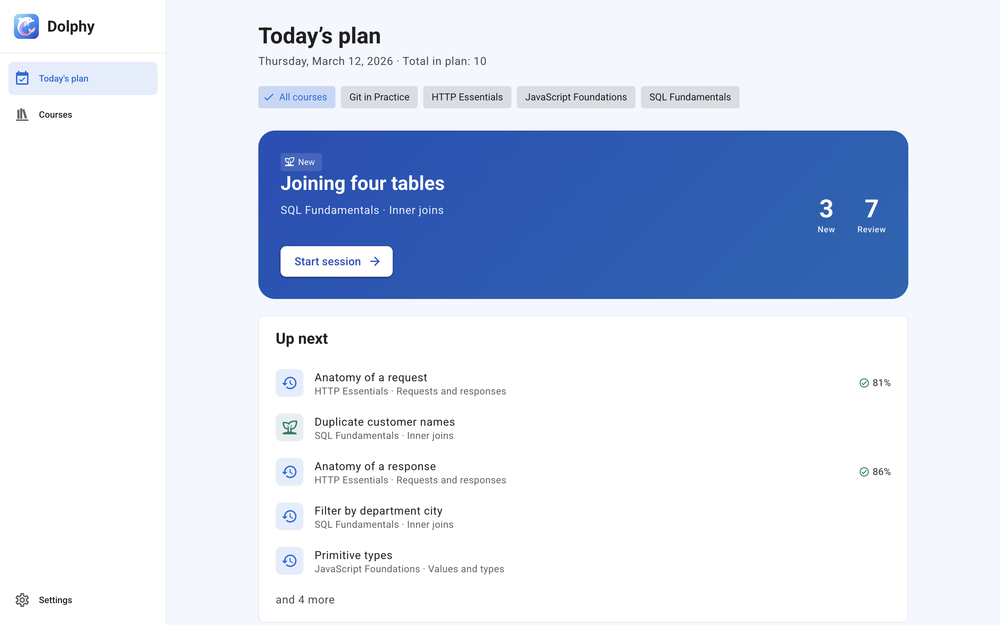
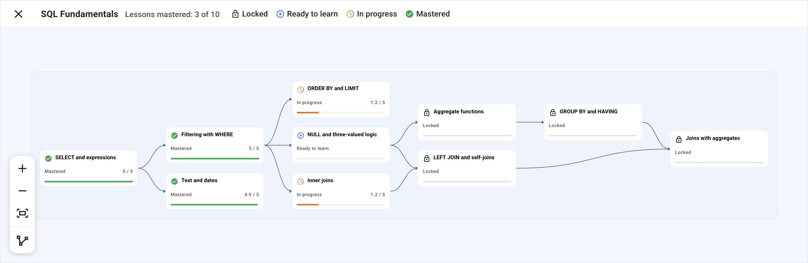
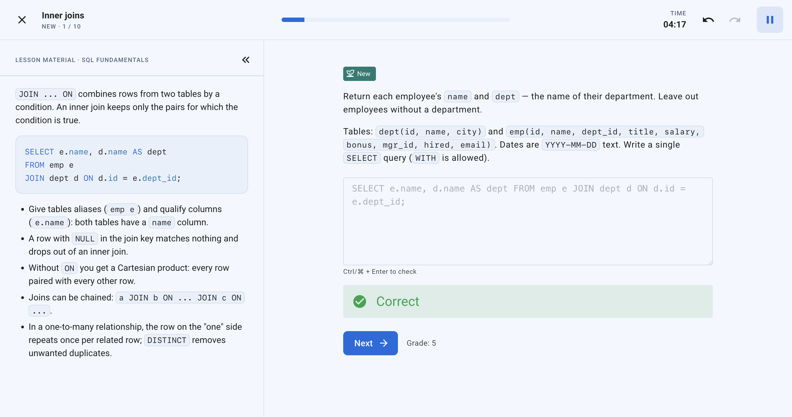
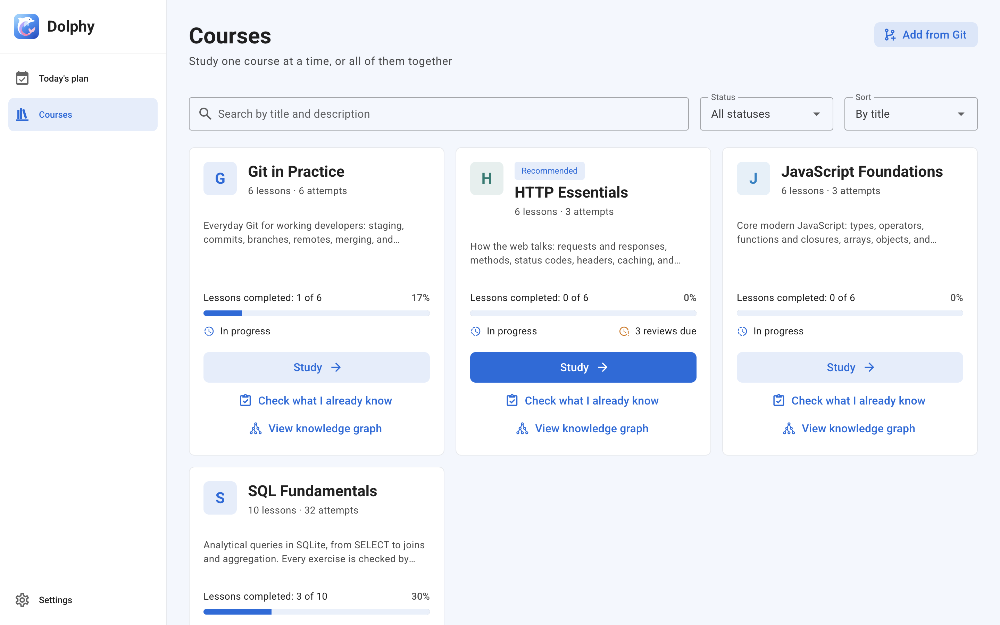

<p align="center">
  
</p>

<h1 align="center">Dolphy</h1>

<p align="center">
  <b>Learn in the right order. Remember for good.</b><br>
  A local-first desktop app for skills that build on each other.
</p>

<p align="center">
  <a href="https://github.com/dolphy-app/dolphy/releases/latest"></a>
  <a href="https://github.com/dolphy-app/dolphy/actions/workflows/ci.yml?query=branch%3Adevelop"></a>
  <a href="apps/desktop/LICENSE"></a>
  
</p>

<p align="center">
  <a href="#download">Download</a> ·
  <a href="https://github.com/dolphy-app/courses">Courses</a> ·
  <a href="https://github.com/dolphy-app/extensions">Extensions</a> ·
  <a href="CONTRIBUTING.md">Contributing</a>
</p>

<p align="center">
  <picture>
    <source media="(prefers-color-scheme: dark)" srcset=".github/assets/screenshots/plan-dark.png">
    <source media="(prefers-color-scheme: light)" srcset=".github/assets/screenshots/plan-light.png">
    
  </picture>
</p>

Dolphy is for skills where one thing leads to the next: SQL, Git, HTTP, JavaScript, or anything you can break into lessons. A course is a graph of lessons with prerequisites, and the plan follows it, so you always know what to review, what to learn and what is still locked.

- **Plans your day.** Every morning it picks what to review and which new lesson to start. A lesson opens only once the ones it depends on are mastered.
- **Checks real answers.** Write a SQL query and the app runs it and tells you if it's right. No grading yourself, no fooling yourself.
- **Stays yours.** No account, no server, no telemetry. Courses are plain Markdown files; your progress lives in a single SQLite file on your disk.

## See what's ready, what's due, what's locked

Every lesson is a node: locked, ready, in progress, mastered. Know exactly what unlocks what, and why you're stuck.

<p align="center">
  <picture>
    <source media="(prefers-color-scheme: dark)" srcset=".github/assets/screenshots/graph-dark.png">
    <source media="(prefers-color-scheme: light)" srcset=".github/assets/screenshots/graph-light.png">
    
  </picture>
</p>

## Answers that are checked, not guessed

SQL answers run in an isolated worker against a practice database and are compared with the expected result, JavaScript answers run against the author's tests. Your rating comes from the outcome, not from your mood. Keep failing and the plan pulls in exercises from the lesson's prerequisites instead of letting you grind at a wall.

<p align="center">
  <picture>
    <source media="(prefers-color-scheme: dark)" srcset=".github/assets/screenshots/session-dark.png">
    <source media="(prefers-color-scheme: light)" srcset=".github/assets/screenshots/session-light.png">
    
  </picture>
</p>

## Your courses are just files

A course is a folder of Markdown and small JSON files. Edit it in any editor, keep it in Git, share it as a zip, or add one straight from a repository.

<p align="center">
  <picture>
    <source media="(prefers-color-scheme: dark)" srcset=".github/assets/screenshots/courses-dark.png">
    <source media="(prefers-color-scheme: light)" srcset=".github/assets/screenshots/courses-light.png">
    
  </picture>
</p>

Also in the box:

- **Placement test.** A short adaptive quiz finds what you already know, so a course starts where you are, not at page one.
- **Several courses at once.** Switch focus between courses; each keeps its own progress.
- **Tunable scheduler.** Choose how much is new, how many lessons run in parallel and how strongly you want to remember things.
- **Extensions.** New exercise types, themes, commands and panels, installed from a [catalog](https://github.com/dolphy-app/extensions) without a restart.
- **Light and dark themes**, interface in English and Russian.

If you know Anki, you'll feel at home: spaced repetition on FSRS, a daily queue, a rating after each item. Dolphy adds structure, verification by running code, and a sense of progress. It is not an Anki replacement for vocabulary or trivia; it is aimed at skills with a dependency structure.

## Download

Installers for macOS (`.dmg`), Windows (`.exe`) and Linux (`.AppImage`) are attached to every [GitHub release](https://github.com/dolphy-app/dolphy/releases/latest). They are not signed yet, so your system warns you on first launch.

<details>
<summary>First launch of an unsigned build</summary>

- **macOS**: Gatekeeper reports _"Dolphy" Not Opened_ because the app isn't notarized. Click **Done** (not _Move to Trash_), open **System Settings → Privacy & Security**, scroll to the message about Dolphy and click **Open Anyway**. Or remove the quarantine flag and open the app as usual:

  ```sh
  xattr -dr com.apple.quarantine /Applications/Dolphy.app
  ```

- **Windows**: SmartScreen shows _Windows protected your PC_. Click **More info → Run anyway**.
- **Linux**: make the file executable (`chmod +x Dolphy-Linux-*.AppImage`) and run it.

</details>

The installer doesn't include courses yet. Drop a course folder into the app's `library` folder and press **Settings → Library → Reload**, or use **Courses → Add from Git** with [dolphy-app/courses](https://github.com/dolphy-app/courses). To see the app with real content right away, [run it from source](CONTRIBUTING.md#run-from-source) with the sample courses.

## Built on Trane

Dolphy stands on [**Trane**](https://github.com/trane-project/trane), an open-source practice engine written in Rust for mastering complex, hierarchical skills. Trane's core idea is the one this project is built around: skills form a graph, practice follows it, new skills unlock as their prerequisites are mastered, and old ones are reinforced along the way. We read Trane's source, ran experiments against it, then ported its scheduler to TypeScript and added a FSRS memory model, answers verified by runners, a placement test and a mergeable multi-device journal. If you want a Rust library or a terminal workflow, go straight to Trane.

## Contributing

Bug reports, courses and extensions are welcome. Setup, commands and the workflow are in [CONTRIBUTING.md](CONTRIBUTING.md).

## License

[MIT](LICENSE).
